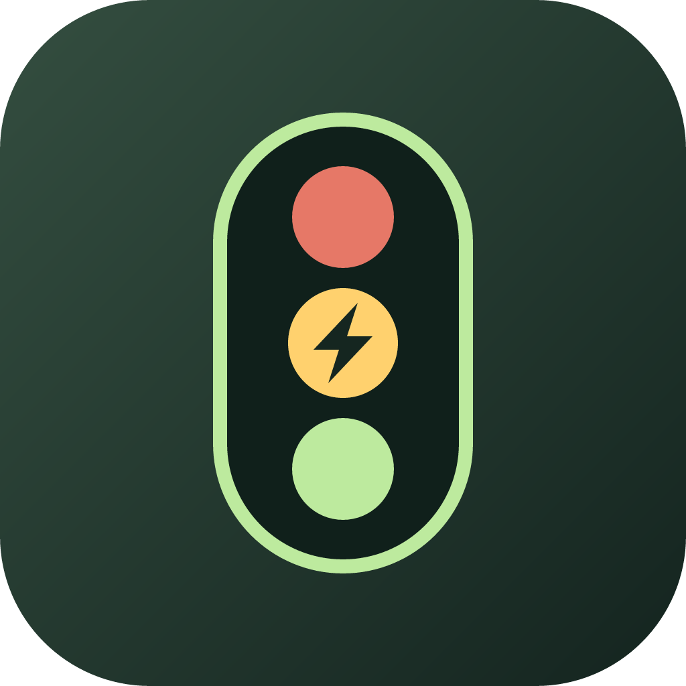

# LocalAgentLight



LocalAgentLight is a small native macOS app that turns Claude Code and Codex lifecycle events into light and sound cues. Open it from Applications to start listening. Close its window or press **Command–Q** to send the lights-off command and stop listening.

## Requirements

- macOS 13 or later and Apple’s Xcode or Command Line Tools to build.
- A **PromLight** paired with macOS over Bluetooth, or an **AgentCore-Light** device that implements the V0.4 BLE GATT protocol. You can try the app in simulation mode without a lamp.
- Claude Code or Codex with local command hooks for automatic status updates.

PromLight uses Bluetooth HID (VID `07D7`, PID `6B01`) and plays alerts through the Mac. AgentCore-Light V0.4 uses a separate BLE transport and can play alerts through the lamp’s buzzer when supported. The app’s interface is currently in Vietnamese. This guide includes the labels you’ll see.

## Build and install

Clone the repository and run the build script:

```sh
git clone https://github.com/quyendang/LocalAgentLight.git
cd LocalAgentLight
/bin/sh build.sh
```

The script builds for the current Mac, adds an ad-hoc signature, and runs the protocol self-test. It uses the installed Apple toolchain and requires no package manager.

In Finder, open the repository’s `dist` folder. Drag **LocalAgentLight.app** into **Applications**, then double-click it. Terminal is only needed to build or run optional diagnostics. The app stays active while its window is minimized.

## Connect your lamp

- **PromLight:** In **System Settings → Bluetooth**, connect the device named **PromLight**. Open LocalAgentLight and wait for **Đã kết nối** (Connected). Connect one PromLight at a time so the app can select it safely.
- **AgentCore-Light V0.4:** Open **Đổi thiết bị…** (Change device), choose **Quét Bluetooth** (Scan Bluetooth), and select the lamp. Allow Bluetooth access if macOS asks.
- **Try without a lamp:** In **Đổi thiết bị…**, select **Mô phỏng** (Simulation).

Under **Thử trạng thái** (Test states), select **Làm việc** (Working), **Chờ** (Waiting), **Hoàn tất** (Done), **Lỗi** (Error), or **Tắt đèn** (Lights off). **Tắt tiếng báo** mutes sound cues. The app shows **Đèn đã xác nhận** when the lamp acknowledges the command.

## Connect Claude Code or Codex

1. Open the installed copy of the app from Applications. Hook commands use the location of the copy that generates the template.
2. Click **Thiết lập hook** (Hook setup), select a tool, and click **Sao chép JSON** (Copy JSON).
3. Paste or merge the copied template into the appropriate file:

   | Tool | User-level hook file |
   | --- | --- |
   | Claude Code | `~/.claude/settings.json` |
   | Codex | `~/.codex/hooks.json`, or `hooks.json` under your configured `CODEX_HOME` |

   Create the file if it does not exist. If it already exists, preserve its other keys and hooks. For events already listed under `hooks`, append the new handler group to the existing array for that event. The app can open the default configuration folder in Finder.
4. Restart the tool and submit a prompt in a local session. In Claude Code, use `/hooks` to see registered hooks. If Codex asks you to trust the commands, review them under **Settings → Hooks** and confirm that they point to your installed app.

[Claude Code hooks reference](https://code.claude.com/docs/en/hooks) · [Codex hooks reference](https://learn.chatgpt.com/docs/hooks)

The most recent active tool controls the lamp. The app tracks one active tool and does not track individual conversation IDs. Completion and error cues return to silent waiting after four seconds. In the desktop app, **Tự tắt đèn sau 5 phút chờ** (Turn off after 5 minutes of waiting) is on by default. A new waiting event restarts the timer, and hooks continue to update the lamp after it turns off. You can disable the setting under **Thiết bị** (Device).

## Privacy and runtime behavior

The hook executable ignores its JSON input and sends two bytes over a per-user Unix socket: a tool identifier and a state identifier. There is no HTTP listener, telemetry, automatic updater, third-party runtime dependency, or login item. The app does not read prompts, transcripts, project files, or API keys. Its preferences store your selected V0.4 device and mute setting locally.

Other processes running under the same macOS account can send a fake light state. The app does not change how Claude Code or Codex connects to its provider.

## Troubleshooting and removing the app

- **PromLight is connected in Bluetooth but not in the app:** Wake the lamp, make sure only one matching lamp is connected, and reopen the app.
- **A LocalAgentLight session is already running:** Quit the existing GUI or command-line instance, then click **Thử lại** (Retry).
- **The light works with the test buttons but not with automatic hooks:** Check that the hook points to the installed executable and is loaded and trusted by the tool. Regenerate the template if the app was moved.
- **Uninstall:** Quit the app, remove the handler groups that reference LocalAgentLight from your hook files, and move LocalAgentLight.app from Applications to the Trash.

To test without hardware, quit the app, build it, then run:

```sh
/bin/sh test-local.sh
```

## Protocol references

- [AgentCore-Light BLE V0.4 specification from AI-Light](https://github.com/quyendang/ai-light/blob/baf3c49/docs/design/%E8%93%9D%E7%89%99%E7%A1%AC%E4%BB%B6%E8%83%BD%E5%8A%9B%E6%8E%A5%E5%8F%A3%E5%8D%8F%E8%AE%AE%E8%AE%BE%E8%AE%A1%E8%AF%B4%E6%98%8E%E4%B9%A6_V0.4.md)
- [PromLight Universal HID protocol reference](https://github.com/isaaclimmy/promlight-universal/blob/67c30ab442c60047ddc42c3fe7d18304b9028cc9/Sources/PromLightCore/AtomicProtocol.swift)
